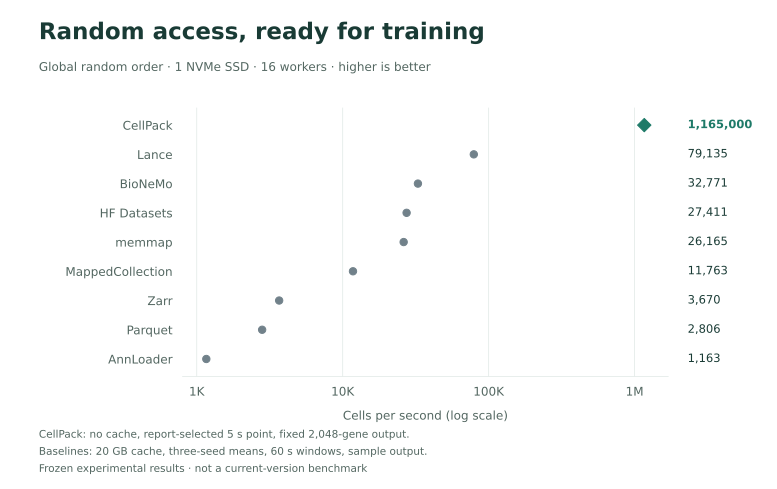
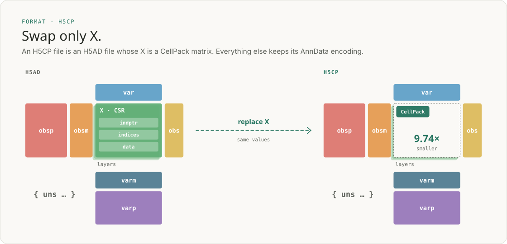
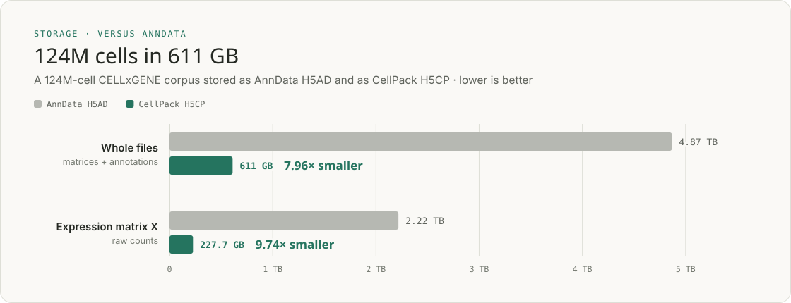
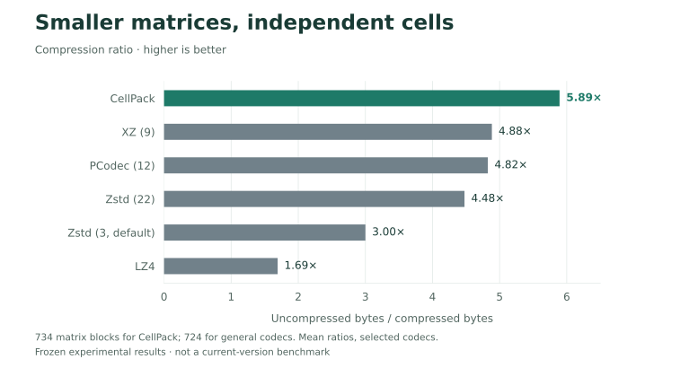
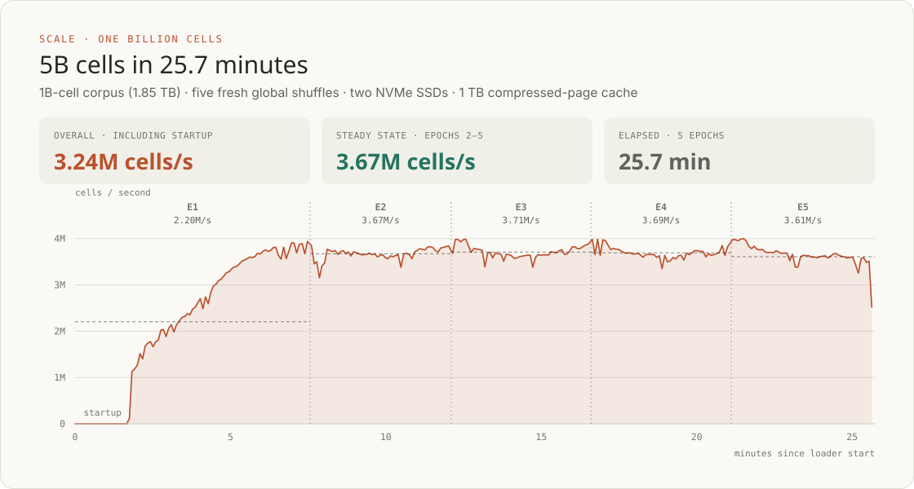

<p align="center">
  
</p>

<h1 align="center">CellPack</h1>

<p align="center">
  <strong>Compact single-cell storage. Million-cell-per-second loading. Built for AnnData.</strong>
</p>

<p align="center">
  <a href="https://pypi.org/project/pycellpack/"></a>
  <a href="https://crates.io/crates/cellpack"></a>
  
  <a href="https://github.com/CladeTeam/CellPack/blob/main/LICENSE"></a>
</p>

<p align="center">
  <a href="https://cladeteam.github.io/CellPack/">Website</a> ·
  <a href="https://cladeteam.github.io/CellPack/python/">Python docs</a> ·
  <a href="https://docs.rs/cellpack">Rust docs</a> ·
  <a href="https://cladeteam.github.io/CellPack/report.html">Technical report</a>
</p>

CellPack is a storage format and data loader for single-cell expression
matrices. Every cell is a compressed record that can be read on its own, so
shuffled training batches stream straight from disk at over a million cells
per second. Your AnnData files stay AnnData files, at a fraction of the size.

## Install

```sh
pip install pycellpack            # Python
pip install "pycellpack[anndata]" # with AnnData integration
uv add pycellpack                 # or with uv
cargo add cellpack                # Rust
```

Start with the [Python quickstart](https://cladeteam.github.io/CellPack/python/docs/quickstart.html).

## 1.165M cells/s from one SSD

Training wants shuffled cells. CellPack reads, decodes and batches them in any
order you choose.

<picture>
  <source media="(prefers-color-scheme: dark)" srcset="https://raw.githubusercontent.com/CladeTeam/CellPack/main/assets/performance-loading-dark.svg">
  
</picture>

## Keep your AnnData workflow

An H5CP file is an H5AD file whose expression matrix `X` is a CellPack matrix.
Everything else stays as it is, so `obs`, `var`, embeddings and metadata work
as before.

<picture>
  <source media="(prefers-color-scheme: dark)" srcset="https://raw.githubusercontent.com/CladeTeam/CellPack/main/assets/anndata-integration-dark.svg">
  
</picture>

```python
import pycellpack as cp

cp.write_h5cp("cells.h5cp", adata, encode=True)
cells = cp.read_h5("cells.h5cp", lazy=True)
subset = cells[cell_ids, gene_ids].to_memory()  # an AnnData object for Scanpy
```

The same file feeds the PyTorch loader. See the
[AnnData guide](https://cladeteam.github.io/CellPack/python/docs/anndata.html).

## 7.96× smaller than AnnData

A 124M-cell corpus, with its counts and annotations, takes 2.28 TB as H5AD
and **286 GB** as H5CP. The counts matrix alone shrinks **9.74×**, from
2.22 TB to 227.7 GB.

<picture>
  <source media="(prefers-color-scheme: dark)" srcset="https://raw.githubusercontent.com/CladeTeam/CellPack/main/assets/performance-storage-dark.svg">
  
</picture>

## Built for single-cell data

General-purpose codecs need large blocks of cells to compress well. CellPack
reaches **5.89×** while keeping every cell readable on its own.

<picture>
  <source media="(prefers-color-scheme: dark)" srcset="https://raw.githubusercontent.com/CladeTeam/CellPack/main/assets/performance-compression-dark.svg">
  
</picture>

## One billion cells

Five shuffled epochs over a 1B-cell corpus: 5 billion cells in 25.7 minutes.

<picture>
  <source media="(prefers-color-scheme: dark)" srcset="https://raw.githubusercontent.com/CladeTeam/CellPack/main/assets/performance-billion-dark.svg">
  
</picture>

## Learn more

- [Website](https://cladeteam.github.io/CellPack/): how CellPack works, with
  interactive explanations
- [Python documentation](https://cladeteam.github.io/CellPack/python/):
  storage, AnnData, the training loader and the full API
- [Rust documentation](https://docs.rs/cellpack)
- [Technical report](https://cladeteam.github.io/CellPack/report.html):
  methods and full benchmarks

## License

[MIT](https://github.com/CladeTeam/CellPack/blob/main/LICENSE)
